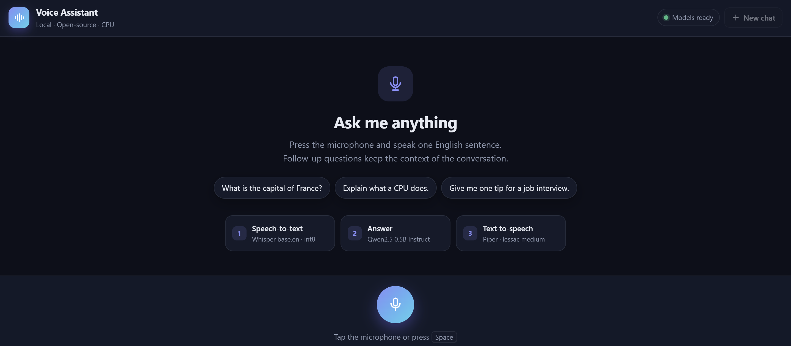
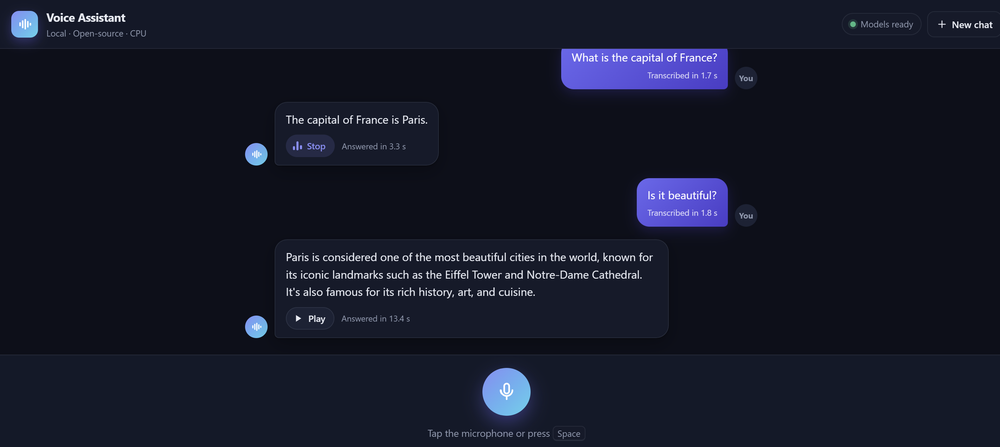
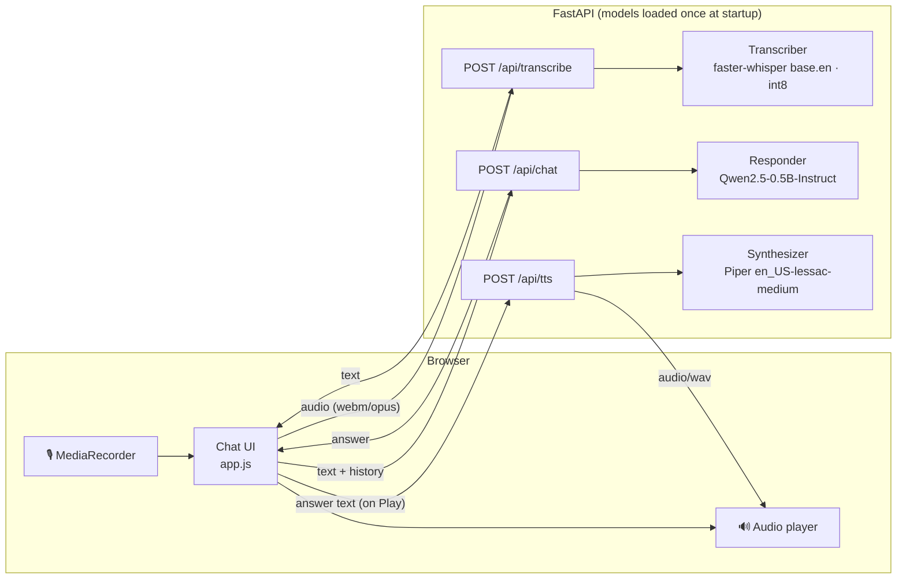

# Local Voice Assistant

**Speak a question, read the answer, hear it back. Everything runs on your own CPU with open-source models: no API keys, no cloud, no GPU.**


A browser-based voice assistant that chains three small open-source models:

1. **Speech-to-text:** [faster-whisper](https://github.com/SYSTRAN/faster-whisper) `base.en` turns your recording into text.
2. **Answer:** [Qwen2.5-0.5B-Instruct](https://huggingface.co/Qwen/Qwen2.5-0.5B-Instruct) writes a short answer and remembers the conversation, so follow-ups such as *"Is it beautiful there?"* work.
3. **Text-to-speech:** [Piper](https://github.com/OHF-Voice/piper1-gpl) reads any answer aloud when you press **Play**.

The backend is a small FastAPI app. The frontend is one HTML page, one vanilla JavaScript file and one CSS file, with no frameworks and no build step.

## Screenshots

Screenshots live in [`docs/screenshots/`](docs/screenshots/).

**Welcome screen:** example questions and the three-model pipeline.



**Conversation:** a follow-up question keeps its context (*"Is it beautiful?"* is understood as Paris); each answer has its own Play / Stop button and per-stage timings.



## Features

- 🎙️ **Record in the browser:** click the mic or press <kbd>Space</kbd>, with a live waveform and a timer.
- 📝 **Accurate English transcription** on CPU with int8 quantization.
- 💬 **Multi-turn conversation:** follow-up questions keep their context. The history lives in the page, so the server stays stateless.
- 🔊 **Play any answer:** every answer has its own Play / Stop button, and audio is cached after the first play.
- ⏱️ **Per-stage timings** under every message (*Transcribed in 0.4 s*, *Answered in 0.8 s*).
- 💡 **Example questions** on the welcome screen, for demos without a microphone.
- 🌗 **Light and dark theme**, mobile layout and keyboard support, with no external fonts or CDNs.
- 🛡️ **Input validation** with clear error messages; uploaded audio is never written to disk.

## How it works



1. The browser records your voice with the **MediaRecorder API** and uploads it.
2. `/api/transcribe` decodes the audio in memory (PyAV) and transcribes it with Whisper.
3. The UI shows the transcript right away, then sends it to `/api/chat` together with the previous turns.
4. Qwen answers in 1–3 sentences using its chat template. The answer is shown with a **Play** button.
5. Pressing **Play** sends that answer to `/api/tts`, and Piper returns a WAV file that the browser plays.

There are three separate endpoints instead of one: the transcript appears while the answer is still being generated, and speech is only synthesised for the answers you actually want to hear.

### Key design decisions

| Decision | Why |
|---|---|
| Models load once in the FastAPI **lifespan** handler | Loading takes seconds and hundreds of MB; every request shares the same instances. `/health` reports `models_loaded` only when all of them are ready. |
| Inference endpoints are plain **`def`**, not `async def` | Inference is CPU-bound and blocking; FastAPI runs `def` endpoints in a threadpool, so the event loop (and `/health`) stays responsive. |
| **int8** Whisper | About 4× less memory than float32 and faster on CPU, with a negligible accuracy loss. |
| **Stateless conversation memory** | The browser sends the history with each request; the server keeps only the newest 12 messages to bound prompt length and latency. Clients can only send `user` / `assistant` roles, never `system`. |
| **TTS warm-up** at startup | The first ONNX inference is slow (~5 s); running it once at startup makes the first real request take ~0.2 s. |
| **In-memory audio** | Uploads are read into `BytesIO`; generated speech is written to an in-memory WAV. Nothing touches the disk. |

## Tech stack

| Component | Choice | Why this one |
|---|---|---|
| Speech-to-text | faster-whisper `base.en` (CTranslate2, int8) | ~145 MB, 2–4× faster than the reference Whisper on CPU, no PyTorch needed |
| Language model | Qwen2.5-0.5B-Instruct (Transformers, CPU) | ~1 GB of weights, answers in about 1–5 s on CPU, good instruction following for its size |
| Text-to-speech | Piper `en_US-lessac-medium` (ONNX Runtime) | ~63 MB voice, about 8× faster than real time on CPU, natural-sounding |
| Backend | FastAPI + Uvicorn, pydantic-settings | Typed validation, automatic OpenAPI docs at `/docs`, settings from env vars |
| Frontend | HTML + vanilla JS + CSS | No build step; MediaRecorder, Web Audio and `fetch` cover everything |

## Project structure

```
voice-assistant-asr-tts/
├── app/
│   ├── main.py            # FastAPI app: lifespan model loading, routes, validation
│   ├── config.py          # Settings from VA_* environment variables / .env
│   ├── asr.py             # Transcriber   (faster-whisper)
│   ├── llm.py             # Responder     (Qwen2.5-0.5B-Instruct)
│   ├── tts.py             # Synthesizer   (Piper) -> WAV bytes
│   ├── schemas.py         # Pydantic request/response models
│   ├── templates/index.html
│   └── static/            # app.js, style.css
├── scripts/
│   └── download_voice.py  # Downloads the Piper voice into models/piper/
├── docs/
│   └── screenshots/       # Screenshots used in this README
├── models/                # Downloaded Piper voice (git-ignored)
├── requirements.txt
└── .env.example
```

## Getting started

### Requirements

- **Python 3.10 or newer** (developed and tested on 3.10.9)
- About **3 GB of free RAM** while running, and about **1.3 GB of disk** for the models
- A recent Chrome, Edge or Firefox with a microphone
- Internet access for the **first** run only (models are downloaded from Hugging Face)

### 1. Install

<details open>
<summary><b>Windows (PowerShell)</b></summary>

```powershell
git clone https://github.com/niusha-yaghini/voice-assistant-asr-tts.git
cd voice-assistant-asr-tts

python -m venv .venv
.\.venv\Scripts\Activate.ps1

python -m pip install --upgrade pip
# CPU-only PyTorch first (much smaller than the default CUDA build)
pip install torch==2.14.1 --index-url https://download.pytorch.org/whl/cpu
pip install -r requirements.txt
```

If PowerShell blocks `Activate.ps1`, run `Set-ExecutionPolicy -Scope CurrentUser RemoteSigned` once, or call `.\.venv\Scripts\python.exe` directly.
</details>

<details>
<summary><b>Linux / macOS (bash)</b></summary>

```bash
git clone https://github.com/niusha-yaghini/voice-assistant-asr-tts.git
cd voice-assistant-asr-tts

python3 -m venv .venv
source .venv/bin/activate

python -m pip install --upgrade pip
# CPU-only PyTorch first (much smaller than the default CUDA build)
pip install torch==2.14.1 --index-url https://download.pytorch.org/whl/cpu
pip install -r requirements.txt
```
</details>

### 2. Download the voice

```bash
python scripts/download_voice.py
```

This saves `en_US-lessac-medium.onnx` and `.onnx.json` (~63 MB) from [`rhasspy/piper-voices`](https://huggingface.co/rhasspy/piper-voices) into `models/piper/`. Use `--voice en_GB-alan-medium` (or any other Piper voice name) to try a different one, and set `VA_PIPER_VOICE` to match.

### 3. Run

```bash
python -m uvicorn app.main:app --reload --port 8001
```

Open **http://127.0.0.1:8001**. The interactive API docs are at **http://127.0.0.1:8001/docs**.

> **First run:** the Whisper (~145 MB) and Qwen (~1 GB) models are downloaded from Hugging Face automatically and cached in `~/.cache/huggingface`. This can take a few minutes; later starts take about 5–10 seconds. When the models are cached you can skip all network checks with `HF_HUB_OFFLINE=1`.

A successful start looks like this:

```
ASR model 'base.en' loaded in 0.52s
LLM 'Qwen/Qwen2.5-0.5B-Instruct' loaded in 3.25s
TTS voice 'en_US-lessac-medium' loaded in 2.70s
Startup finished in ...s
Application startup complete.
```

Any free port works; `8001` is only used here because `8000` is often taken by other dev servers. The microphone only works on `localhost` / `127.0.0.1` or over HTTPS, because browsers restrict it to secure origins.

## Configuration

All settings are optional. Set them as environment variables or copy `.env.example` to `.env`.

| Variable | Default | Description |
|---|---|---|
| `VA_WHISPER_MODEL` | `base.en` | faster-whisper model name |
| `VA_WHISPER_DEVICE` | `cpu` | Inference device |
| `VA_WHISPER_COMPUTE_TYPE` | `int8` | Quantization (`int8`, `float32`, …) |
| `VA_LLM_MODEL` | `Qwen/Qwen2.5-0.5B-Instruct` | Hugging Face model id |
| `VA_LLM_MAX_NEW_TOKENS` | `120` | Maximum answer length in tokens |
| `VA_LLM_MAX_HISTORY_MESSAGES` | `12` | Previous messages sent to the model (6 exchanges) |
| `VA_PIPER_VOICE` | `en_US-lessac-medium` | Piper voice name |
| `VA_PIPER_MODEL_DIR` | `models/piper` | Voice folder (relative to the project root) |
| `VA_MAX_TTS_CHARS` | `1000` | Longest text accepted by `/api/tts` |
| `HF_HUB_OFFLINE` | – | Set to `1` to use cached models without network access |
| `HTTPS_PROXY`, `HF_ENDPOINT` | – | Download through a proxy or a Hugging Face mirror |

## API

| Method | Path | Request | Response |
|---|---|---|---|
| `GET` | `/` | – | The web app |
| `GET` | `/health` | – | `{"status": "ok", "models_loaded": true}` |
| `POST` | `/api/transcribe` | multipart field `audio` (webm / ogg / wav, ≤ 10 MB) | `{"text": "..."}` |
| `POST` | `/api/chat` | `{"text": "...", "history": [{"role": "user" \| "assistant", "content": "..."}]}` | `{"answer": "..."}` |
| `POST` | `/api/tts` | `{"text": "..."}` | `audio/wav` bytes |

Invalid input gets a `400` with a readable `detail` message: empty or oversized audio, undecodable audio, empty text, text over 500 characters (or 1000 for TTS). Inference failures return `500` and are logged on the server. `history` is optional.

```bash
curl -F "audio=@question.wav" http://127.0.0.1:8001/api/transcribe

curl -X POST http://127.0.0.1:8001/api/chat -H "Content-Type: application/json" \
     -d '{"text": "Is it beautiful there?", "history": [
          {"role": "user", "content": "What is the capital of France?"},
          {"role": "assistant", "content": "The capital of France is Paris."}]}'

curl -X POST http://127.0.0.1:8001/api/tts -H "Content-Type: application/json" \
     -d '{"text": "The capital of France is Paris."}' --output answer.wav
```

## Performance

Measured on an Intel Core i9-13900H laptop CPU (14 cores, 16 GB RAM, Windows 11, no GPU); your numbers will vary with hardware:

| Step | Time |
|---|---|
| Transcribe a 2.5 s recording | ~0.5 s |
| Short answer (≈ 8 tokens) | ~0.8 s |
| Three-sentence answer (≈ 60 tokens) | ~4.8 s (up to ~13 s observed in the browser when the CPU is busy) |
| Synthesize 1.8 s of speech | ~0.2 s |
| Server memory with all models loaded | ~2.4 GB |

## Troubleshooting

| Symptom | Fix |
|---|---|
| `/docs` shows another app's page (e.g. a Django 404) | Another server already uses that port. Run with `--port 8001` (or any free port). |
| `ModuleNotFoundError` on start | `uvicorn` is resolving to a different Python (e.g. Anaconda). Activate the venv and use `python -m uvicorn ...`. |
| Startup hangs while loading a model | Only run **one** server at a time. Two `--reload` servers downloading the same model can block on the Hugging Face cache lock; stop them and delete `*.incomplete` files under `~/.cache/huggingface/hub/`. |
| `Piper voice files not found` | Run `python scripts/download_voice.py`. |
| "Microphone access was blocked" | Allow the microphone from the icon in the address bar, and open the app via `localhost` / `127.0.0.1`. |
| Warning about symlinks on Windows | Harmless; Hugging Face falls back to copying files into its cache. |

## Limitations

- **English only:** the `base.en` model and the English voice.
- **CPU latency:** a few seconds per longer answer, and answers are not streamed yet.
- **Small model quality:** a 0.5 B model can be wrong or shallow on harder questions.
- **Memory resets on reload:** the conversation lives in the page, by design.

## Roadmap

- [ ] Automated API tests with pytest
- [ ] Stream LLM tokens and audio to cut perceived latency
- [ ] Persian speech-to-text and text-to-speech
- [ ] Docker image for one-command setup

## Licences of the models and libraries

This project uses third-party models and libraries under their own licences. Check them before redistributing:

| Component | Licence |
|---|---|
| faster-whisper, Whisper `base.en` weights | MIT |
| Qwen2.5-0.5B-Instruct | Apache-2.0 |
| Transformers | Apache-2.0 |
| piper-tts (1.8) | **GPL-3.0-or-later** |
| Piper voice `en_US-lessac-medium` | See the voice's [model card](https://huggingface.co/rhasspy/piper-voices/tree/main/en/en_US/lessac/medium) |
| FastAPI | MIT |
